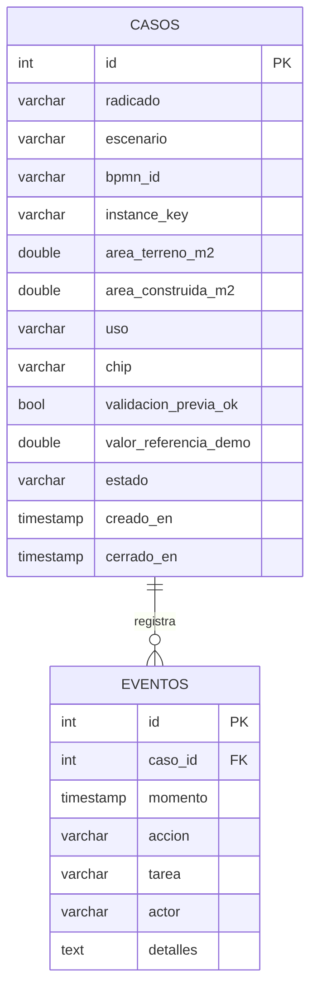

# Modelo entidad relación · ejemplo

`Caso` representa un expediente simplificado e instancia BPMN. `Evento` registra acciones auditables; almacena los detalles como JSON serializado para que el ejemplo funcione en SQLite y PostgreSQL sin migración compleja.

**Para trabajo autónomo:** ampliar `documentos`, `actividades`, `observaciones`, `reglas`, `kpi_snapshot`, `usuarios/roles` sólo después de agregar requisitos EARS y pruebas. Evitar inventar tablas que no sean necesarias en el vertical slice.

Modelo gestionado por SQLAlchemy (`app/db.py`). Vista SQL `vw_preset_casos` creada automáticamente en el arranque.
