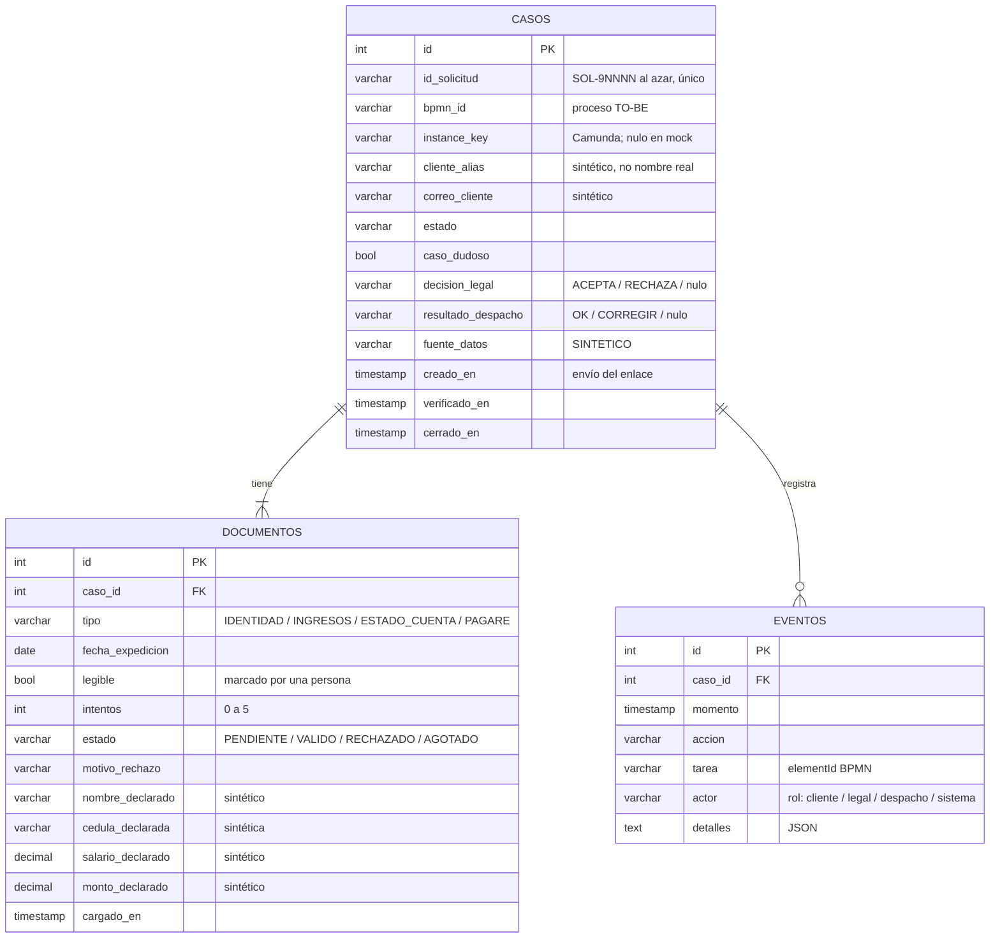

# Modelo de datos del MVP — paso 22 (`/22-datos`)

**Fecha:** 2026-10-26 · **Skill:** `mvp-datos` · **Estado:** **APROBADO** (ronda 18, 2026-10-26). Siguiente: adaptar `app/db.py` con pruebas (requiere Python).
**Base:** `14-mvp/ears-equipo.md` (REQ-MVP-01 a 03, aprobados) y el modelo de ejemplo del kit (`especificaciones/03-modelo-datos.md`: casos + eventos).
**Datos:** SINTÉTICOS. **Efecto en los números:** ninguno.

## Por qué tres tablas y no dos
El kit trae `casos` y `eventos`. REQ-MVP-01 exige contar **intentos por documento** (máximo 5) y guardar su fecha de expedición y motivo de rechazo; eso no cabe limpio en `casos` sin cuatro grupos de columnas repetidas. Se agrega `documentos` (una fila por tipo de documento por caso). Las tareas humanas **no** se guardan en tabla: se derivan del estado del caso (en modo mock) o las da Camunda (modo real), como ya hace el kit.

### Razón de cada atributo (resumen)
| Atributo | Para qué | Requisito |
|---|---|---|
| `id_solicitud` | Identificador de negocio con el **mismo formato de 5 dígitos que `09-datos`** (`SOL-NNNNN`). Se genera al azar en el rango **SOL-90000 a SOL-99999** y se verifica que no exista; así nunca choca con los sintéticos de `09-datos` (SOL-00001 a SOL-08000) | DAT-1 |
| `estado` | Valores: `ENLACE_ENVIADO`, `DOCUMENTOS_RECHAZADOS`, `REVISION_LEGAL`, `VERIFICACION_DESPACHO`, `ESPERANDO_CORRECCION`, `VERIFICADO`, `RUTA_PAPEL` | REQ-MVP-01 a 03 |
| `caso_dudoso`, `decision_legal` | Saber si pasó por Legal y qué decidió | REQ-MVP-02 |
| `resultado_despacho`, `verificado_en` | Cierre del MVP y tiempo de ciclo | REQ-MVP-03 |
| `documentos.intentos`, `estado`, `motivo_rechazo` | Regla de **5 intentos por cada documento**; si se rechaza uno, el cliente vuelve a subir **solo ese documento** | REQ-MVP-01, DAT-2 |
| `fuente_datos` | Marca `SINTETICO` en cada fila que llega a Preset | DAT-3 |
| `fecha_expedicion`, `cargado_en` | Regla de 20 días calendario | REQ-MVP-01, EARS-1 |
| `legible` | Casilla marcada por una persona | EARS-2 |
| `*_declarado` | Comparar nombre, cédula, salario y monto entre documentos | REQ-MVP-02 |
| `eventos.*` | Bitácora con fecha y hora, exportable a CSV | REQ-MVP-03 |

## Qué va a Preset (DAT-3 = c)
Vista `vw_preset_mvp_casos`: todos los campos de `casos` y de `documentos` (incluidos correo, alias y los cuatro datos declarados), más días entre `creado_en` y `verificado_en`, total de intentos y documentos rechazados. Todas las filas llevan `fuente_datos = SINTETICO` y el tablero debe decir **SINTÉTICO / DEMOSTRACIÓN**.

**Riesgo aceptado por la usuaria (ronda 18):** estos campos imitan datos personales. Regla que se mantiene: **si algún día el MVP recibe un caso real, la vista debe excluir `correo_cliente`, `cliente_alias` y los `*_declarado` antes de cualquier carga a Preset** (AGENTS.md, regla 7). La auditoría del paso 26 lo revisará.

## Persistencia
1. **Primero SQLite** (`sqlite:///./mvp.sqlite3`, valor por defecto del kit) con pruebas automáticas.
2. PostgreSQL/Supabase solo si el equipo tiene una conexión válida en un servidor: se configura `DATABASE_URL` en `.env` (nunca en el código ni en el frontend), se crea un rol de **solo lectura** con acceso únicamente a la vista y se exige SSL.
3. Preset Cloud **no** puede leer SQLite directamente; para Preset se usa el CSV exportado o la vista en PostgreSQL.

## Decisiones (ronda 18)
- **DAT-1:** mismo formato que `09-datos` (5 dígitos), al azar en SOL-90000 a SOL-99999.
- **DAT-2:** 4 documentos con **5 intentos por cada documento** (sin cambio respecto a REQ-MVP-01 y REQ-TOBE-005); se vuelve a subir solo el documento rechazado. Los números se mantienen.
- **DAT-3:** opción (c), todos los campos a Preset marcados como sintéticos.
