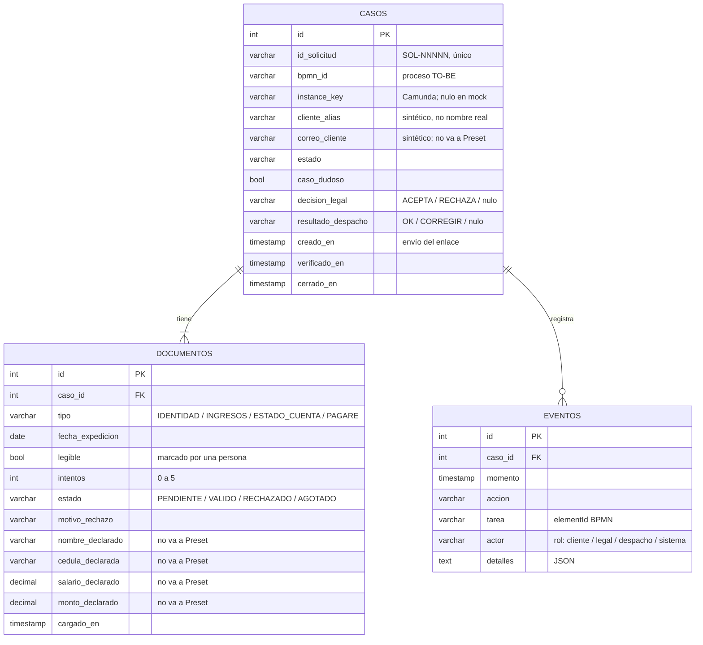

# Modelo de datos del MVP — paso 22 (`/22-datos`)

**Fecha:** 2026-10-26 · **Skill:** `mvp-datos` · **Estado:** **PROPUESTA — pendiente de aprobación (DAT-1 a DAT-3, ronda 18)**. El ORM del kit (`app/db.py`) **no** se modifica hasta aprobarla.
**Base:** `14-mvp/ears-equipo.md` (REQ-MVP-01 a 03, aprobados) y el modelo de ejemplo del kit (`especificaciones/03-modelo-datos.md`: casos + eventos).
**Datos:** SINTÉTICOS. **Efecto en los números:** ninguno.

## Por qué tres tablas y no dos
El kit trae `casos` y `eventos`. REQ-MVP-01 exige contar **intentos por documento** (máximo 5) y guardar su fecha de expedición y motivo de rechazo; eso no cabe limpio en `casos` sin cuatro grupos de columnas repetidas. Se agrega `documentos` (una fila por tipo de documento por caso). Las tareas humanas **no** se guardan en tabla: se derivan del estado del caso (en modo mock) o las da Camunda (modo real), como ya hace el kit.

### Razón de cada atributo (resumen)
| Atributo | Para qué | Requisito |
|---|---|---|
| `id_solicitud` | Identificador de negocio, mismo formato que `09-datos` (`SOL-NNNNN`) | DAT-1 |
| `estado` | Valores: `ENLACE_ENVIADO`, `DOCUMENTOS_RECHAZADOS`, `REVISION_LEGAL`, `VERIFICACION_DESPACHO`, `ESPERANDO_CORRECCION`, `VERIFICADO`, `RUTA_PAPEL` | REQ-MVP-01 a 03 |
| `caso_dudoso`, `decision_legal` | Saber si pasó por Legal y qué decidió | REQ-MVP-02 |
| `resultado_despacho`, `verificado_en` | Cierre del MVP y tiempo de ciclo | REQ-MVP-03 |
| `documentos.intentos`, `estado`, `motivo_rechazo` | Regla de 5 intentos y motivo por documento | REQ-MVP-01 |
| `fecha_expedicion`, `cargado_en` | Regla de 20 días calendario | REQ-MVP-01, EARS-1 |
| `legible` | Casilla marcada por una persona | EARS-2 |
| `*_declarado` | Comparar nombre, cédula, salario y monto entre documentos | REQ-MVP-02 |
| `eventos.*` | Bitácora con fecha y hora, exportable a CSV | REQ-MVP-03 |

## Qué no va a Preset (vista de solo lectura)
Vista propuesta `vw_preset_mvp_casos`: `id_solicitud`, `estado`, `caso_dudoso`, `decision_legal`, `resultado_despacho`, `creado_en`, `verificado_en`, días entre ambos, total de intentos y número de documentos rechazados.
**Excluidos:** `correo_cliente`, `cliente_alias` y los cuatro campos `*_declarado` (aunque sean sintéticos, imitan datos personales).

## Persistencia
1. **Primero SQLite** (`sqlite:///./mvp.sqlite3`, valor por defecto del kit) con pruebas automáticas.
2. PostgreSQL/Supabase solo si el equipo tiene una conexión válida en un servidor: se configura `DATABASE_URL` en `.env` (nunca en el código ni en el frontend), se crea un rol de **solo lectura** con acceso únicamente a la vista y se exige SSL.
3. Preset Cloud **no** puede leer SQLite directamente; para Preset se usa el CSV exportado o la vista en PostgreSQL.

## Preguntas para aprobar (ronda 18)
- **DAT-1:** ¿El caso se identifica con `SOL-NNNNN` (mismo formato que los datos sintéticos de `09-datos`)?
- **DAT-2:** ¿Un caso puede tener **muchos eventos** (uno por cada carga, rechazo, decisión de Legal y verificación) y **exactamente 4 documentos** (uno por tipo, con sus intentos)?
- **DAT-3:** ¿Excluir de Preset el correo, el alias del cliente y los datos declarados (nombre, cédula, salario y monto)?
